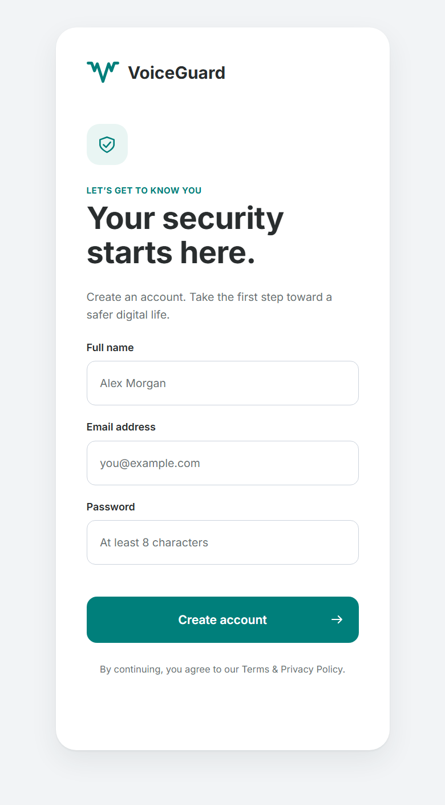
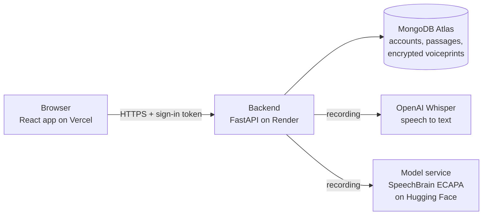
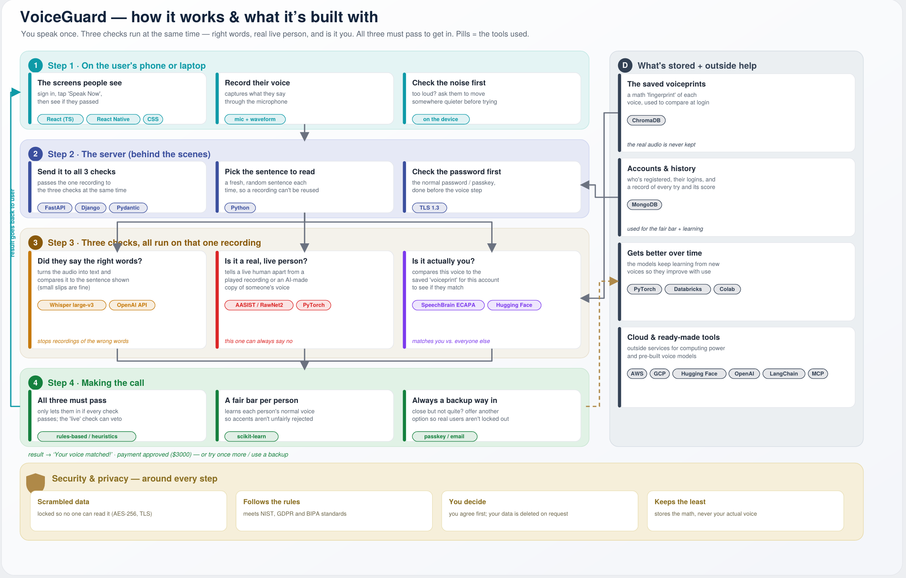

# VoiceGuard

[](https://github.com/sum09fairSaif/voiceguard/actions/workflows/ci.yml)

Voice-biometric multi-factor authentication with anti-spoofing and deepfake detection.

- **Live app:** https://voiceguard-nu.vercel.app/
- **Live API:** https://voiceguard-83cj.onrender.com/ (health check at [`/health`](https://voiceguard-83cj.onrender.com/health), interactive docs at [`/docs`](https://voiceguard-83cj.onrender.com/docs))

> The free hosting tiers sleep when idle, so the first request after a
> while can take up to a minute.

## Problem statement

Passwords and one-time codes are weak or alarming: codes can be phished or
SIM-swapped, and passwords get reused and leaked. Voice is convenient, but a
plain voiceprint can be beaten by a recording or an AI-generated deepfake.
VoiceGuard verifies a person for app login and for approving sensitive
transactions by checking three things at once on a single short recording:
what they said (the prompted words), who they are (their voiceprint), and
that the voice is live and real (not a replay or a synthetic clone).

## What it does

On enrollment, a user records a few short spoken samples and we build an
encrypted voiceprint (a numeric summary of their voice, not the raw audio).
On each login or transaction approval, the user first enters their password,
then the app shows a short passage to read aloud. We run three checks on
that one recording:

1. **Content check:** did they read the prompted words? (defeats replay of an old clip)
2. **Identity check:** does the voice match the enrolled voiceprint?
3. **Liveness check:** is the audio a live human, not a recording or deepfake?

All three must pass, and the liveness check can veto on its own. Only then is
the login or transaction approved. Raw audio is never stored: it is deleted
as soon as the voiceprint is built or the checks have run.

## Project status

Each row is a user story (see the
[story issues](https://github.com/sum09fairSaif/voiceguard/issues?q=label%3Astory)).

| Story | Backend (API) | Frontend (screens) |
|---|---|---|
| #11 Create an account | ✅ Done | ✅ Done |
| #12 Log in with voice | ✅ Password sign-in with lockout | ⏳ Sign-in screen to do |
| #13 Show a challenge passage | ✅ Done | ✅ Done |
| #14 Record and submit the attempt | ✅ Done | ✅ Done |
| #15 Content check | ✅ Done (OpenAI Whisper) | — |
| #10 Enroll voice profile | ✅ Done | ⏳ Enrollment screen to do |
| #16 Identity check | ✅ Done (SpeechBrain ECAPA) | — |
| #17 Liveness / anti-spoof check | ⏳ Not started | — |
| #18 Combine the three checks | 🟡 Content + identity combined; answers "incomplete" until liveness exists | — |
| #19 Result screen with retry | — | ✅ Done |
| #20 Account recovery (email code) | ⏳ Not started | ⏳ Not started |

Because liveness isn't built yet, a correct reading currently ends as
**"Almost there" (incomplete)** rather than approved. That is deliberate:
without liveness, a recording of the user could pass the other two checks.

## Screenshots

| Create account |
|---|
|  |

<!-- To add: docs/screenshots/passage.png (read the phrase) and
docs/screenshots/result.png (result with the check breakdown). -->

## How to use it

1. Open the [live app](https://voiceguard-nu.vercel.app/) and create an account.
2. Read the six-word phrase on screen aloud: tap the microphone, read, tap again to stop, then **Submit**.
3. The result screen shows whether the words and voice matched. Each phrase can be used once and expires after two minutes; **New phrase** gets another.

You can also call the API directly. For example, with `curl`:

```bash
API=https://voiceguard-83cj.onrender.com

# Create an account. The response includes an access token.
curl -X POST $API/api/auth/signup -H "Content-Type: application/json" \
  -d '{"full_name": "Alex Morgan", "email": "alex@example.com", "password": "a-long-password"}'

# Get a passage to read (use the access_token from above).
curl -X POST $API/api/challenge -H "Authorization: Bearer <access_token>"
# -> {"attempt_id": "...", "passage": "tulip river candle ...", "expires_at": "..."}

# Send a recording of the passage being read.
curl -X POST $API/api/verify -H "Authorization: Bearer <access_token>" \
  -F attempt_id=<attempt_id> -F "audio=@attempt.webm;type=audio/webm"
# -> {"decision": "incomplete", "content": {"passed": true, "matched": 6, "total": 6, ...},
#     "identity": "not_enrolled", "liveness": "not_checked", ...}
```

### API endpoints

| Method | Path | What it does | Sign-in needed |
|---|---|---|---|
| GET | `/health` | Is the server up? | No |
| POST | `/api/auth/signup` | Create an account; returns an access token | No |
| POST | `/api/auth/login` | Sign in with email and password; locks for 30 min after 5 wrong tries | No |
| POST | `/api/challenge` | Get a fresh, single-use passage to read (expires in 2 min) | Yes |
| POST | `/api/verify` | Send a recording of the passage; runs the checks and returns the decision | Yes |
| GET | `/api/enroll` | Enrollment progress, and a sentence to read for the next sample | Yes |
| POST | `/api/enroll/samples` | Add one voice sample; the voiceprint is built after 3 good ones | Yes |
| DELETE | `/api/enroll/samples` | Start enrollment over | Yes |

Full request and response details are in the interactive docs at `/docs`.

## Tech stack

| Layer | Choice |
|---|---|
| Frontend | React + TypeScript, built with Vite |
| Backend | FastAPI (Python 3.11), run with uvicorn |
| Database | MongoDB Atlas (accounts, passages, rate limits, sign-in lockouts) |
| Voiceprints | MongoDB, encrypted with Fernet, one per user |
| Content check | OpenAI Whisper (hosted API, `whisper-1`) |
| Identity check | SpeechBrain ECAPA, in a separate model service on Hugging Face Spaces |
| Liveness check | AASIST (planned) |
| Hosting | Vercel (frontend), Render (backend), Hugging Face Spaces (model service) |
| CI/CD | GitHub Actions (lint, tests and build on every PR); Vercel and Render deploy `main` automatically |

## Architecture

How the parts connect today:



The model service runs separately because the voice model needs PyTorch,
which is too large for the backend's free Render instance.

The original design diagram, showing the full planned system including
tools we later swapped out (for example ChromaDB, replaced by encrypted
voiceprints in MongoDB):



## Repository layout

```
backend/        FastAPI app: accounts, passages, voice checks, enrollment
  routers/      one file per group of endpoints
  tests/        pytest tests (run against a fake in-memory database)
frontend/       React + TypeScript app (Vite)
model-service/  voice-embedding service, deployed as a Hugging Face Space
docs/           architecture diagram and screenshots
.github/        CI workflow and pull request template
```

## Local setup

### Prerequisites

- **Python 3.11**, the version CI and Render use. Newer versions may fail to install the pinned packages (3.14 does). Check with `python --version`; on Windows, `py -3.11` picks 3.11 if you have several.
- **Node.js 22 or newer**, with npm.
- **ffmpeg**, only if you run the model service or its tests.
- Accounts for the features you want to try (see the next section).

### 1. Clone and create your `.env`

```bash
git clone https://github.com/sum09fairSaif/voiceguard.git
cd voiceguard
cp .env.example .env        # Windows (cmd): copy .env.example .env
```

Fill in `.env`. It is git-ignored: never commit it.

| Setting | Needed for | How to get it |
|---|---|---|
| `MONGO_URI` | Everything except `/health` | Create a free cluster on [MongoDB Atlas](https://www.mongodb.com/atlas), then **Connect → Drivers** and copy the connection string. Allow your IP under **Network Access**. |
| `JWT_SECRET` | Everything except `/health` | Any long random string: `python -c "import secrets; print(secrets.token_urlsafe(32))"` |
| `OPENAI_API_KEY` | `/api/verify` (content check) | [platform.openai.com](https://platform.openai.com/api-keys). Each check is a paid call. |
| `VOICEPRINT_KEY` | Enrollment and identity check | `python -c "from cryptography.fernet import Fernet; print(Fernet.generate_key().decode())"` (run after installing the backend) |
| `EMBEDDING_SERVICE_URL`, `EMBEDDING_SERVICE_TOKEN` | Enrollment and identity check | Your model service's address and token (step 3). |

Every other setting has a working default. Without the OpenAI or model
service settings, the app still runs; those checks answer "temporarily
unavailable" instead.

### 2. Backend

```bash
cd backend
python -m venv venv            # use: py -3.11 -m venv venv  if 3.11 isn't your default
source venv/bin/activate       # Windows: venv\Scripts\activate
pip install -r requirements-dev.txt
uvicorn main:app --reload --port 8000
```

Open http://localhost:8000/health. You should see
`{"status":"ok","service":"voiceguard-api"}`, and the interactive API docs
are at http://localhost:8000/docs. More detail: [backend/README.md](backend/README.md).

### 3. Model service (optional: only for enrollment and the identity check)

Run it locally or deploy it as a Hugging Face Space. Both are described in
[model-service/README.md](model-service/README.md). Then set
`EMBEDDING_SERVICE_URL` and `EMBEDDING_SERVICE_TOKEN` in `.env`.

### 4. Frontend

In a second terminal:

```bash
cd frontend
npm install
npm run dev
```

Open the address it prints (usually http://localhost:5173). It talks to
the backend at http://localhost:8000. To use a different backend, put
`VITE_API_BASE_URL=<address>` in `frontend/.env.local`.

### Running the tests

None of the test suites need a database or API keys.

From the repository root:

```bash
cd backend && python -m pytest         # backend
cd frontend && npm test                # frontend
cd frontend && npm run lint            # frontend lint
cd model-service && python -m pytest   # model service (needs ffmpeg)
```

CI runs all of these, plus `ruff check` on the Python code, on every pull
request.

## MVP scope

- Enroll a voice profile (record samples, build and store an encrypted voiceprint)
- Log in by reading a prompted passage aloud
- The three-check verification pipeline (content, identity, liveness)
- A clear pass / fail result screen with a retry path
- Basic account and session handling

## Out of scope (not in the MVP)

- Authenticating live phone callers into a call center
- Native mobile app (web first; React Native comes later)
- Languages other than English
- On-device (offline) verification

## Success criteria

- A user can enroll a voice profile end to end.
- A user can log in by reading a prompted passage, and the three checks run.
- A known replay clip is rejected by the content or liveness check.
- The frontend and backend are both deployed and reachable at public URLs.
- The team can run the whole thing locally from the instructions in this repo.

## External services and accounts

- **MongoDB Atlas:** database
- **OpenAI API:** speech-to-text for the content check (paid per call; capped per user by rate limits)
- **Hugging Face Spaces:** hosts the model service (free ZeroGPU hardware)
- **Vercel:** frontend hosting
- **Render:** backend hosting

## Top risks and mitigations

1. Liveness / deepfake detection may not generalize to new attack types.
   Mitigation: start with a published anti-spoofing model, keep a held-out
   test set of attacks, and treat liveness as a veto so a weak pass never
   approves on its own.
2. Voice data is sensitive. Mitigation: store only encrypted voiceprints,
   never raw audio, and keep secrets out of the repo via environment variables.
3. Paid speech-to-text calls could be abused. Mitigation: per-user limits on
   passages and checks, a cap on new accounts, and one log line per call.
4. The three-month timeline is tight for a small team. Mitigation: ship the
   skeleton in Sprint 0, then build one user story per feature branch behind
   passing CI.

## Contributing

Branches, commit messages and pull requests follow
[CONTRIBUTING.md](CONTRIBUTING.md). Every pull request goes into `dev`,
fills in the pull request template, and needs one approving review and
green CI before it merges.

## Team and mentors

- Team: Sumehra, Nicole, Tulika, Gabriel
- Technical mentors: Sesha Varanasi, Duo Xu, Parth Sabhadiya, Drew Abram, Chaitanya Challa
